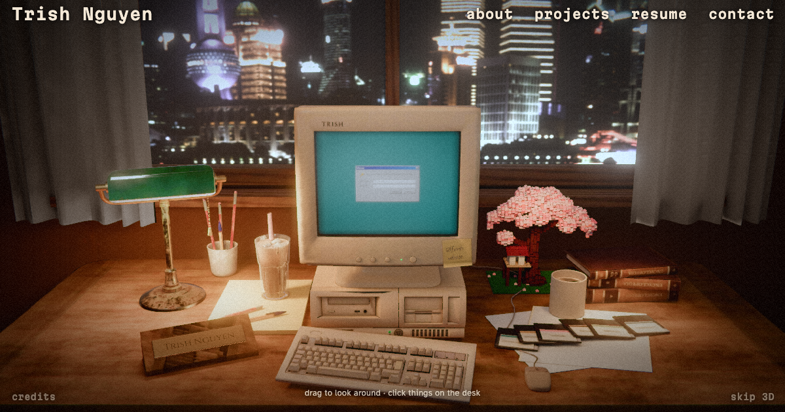

# Trish Nguyen — interactive site

A cozy desk with a working Windows 98 desktop on its CRT. Live at **[trish-nguyen.com](https://trish-nguyen.com)**.



## What it is

A 3D retro CRT desk portfolio. The room is an authored Blender scene with its lighting baked offline in Cycles, shown in Three.js with cheap materials. Zoom into the monitor and a functional Win98 desktop (login, windows, projects, resume) runs inside it. A plain HTML lo-fi version, reachable through "skip 3D", covers slow connections and devices without WebGL.

## Tech stack

Three.js, Blender (Cycles bakes, exported as `scene.glb`), Vite, postprocessing, GSAP, 98.css.

## Run locally

```sh
npm install
npm run dev                         # dev server
npm run build && npm run preview    # production preview at http://127.0.0.1:4320
npm test                            # needs the preview running and Chromium for Playwright
```

Other scripts (build checks, profiling, review screenshots) are in [docs/scripts.md](docs/scripts.md).

## Project structure

```text
src/scene/     GLB loading, camera rig, navigation, post-processing
src/desktop/   Win98 desktop: session, windows, apps
src/overlay/   projects the live desktop onto the CRT screen
src/lofi/      plain HTML "skip 3D" version
src/content/   about, projects, resume, credits
art/           Blender source, bake scripts, textures (not shipped)
public/        shipped models, fonts, icons, og.png
scripts/       build checks, asset tooling, profiling
tests/         Node and Playwright checks
docs/          architecture, scene contract, deployment
```

## Deploys

Pushing to `theme/crt-baked` triggers GitHub Actions, which builds the app and publishes `dist/` to GitHub Pages at [trish-nguyen.com](https://trish-nguyen.com). Other themes live on their own branches. See [docs/deployment.md](docs/deployment.md).

## Credits

Third-party models, textures, fonts and code are listed in [art/credits.md](art/credits.md). Full license texts for the bundled libraries are at [trish-nguyen.com/third-party-licenses.txt](https://trish-nguyen.com/third-party-licenses.txt) (generated at build time by [scripts/third-party-licenses.mjs](scripts/third-party-licenses.mjs)).

Third-party assets keep their own licenses. Everything else is © 2026 Trish Nguyen, all rights reserved.
